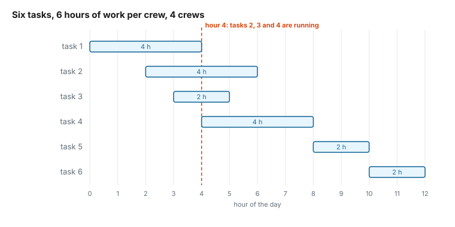
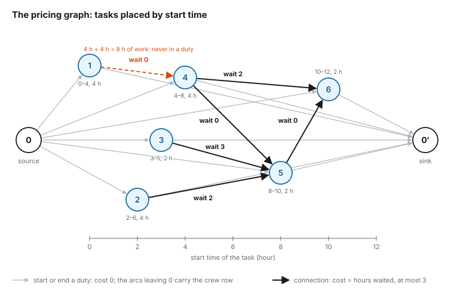
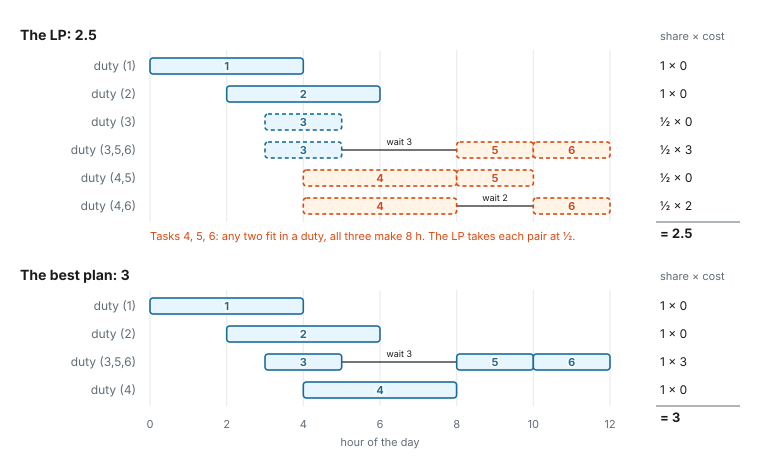

# Case study: crew scheduling

The theory pages use vehicle routing as their example. This page runs the same method on another problem from page
1's table, **crew scheduling**, with an instance small enough to check by hand. It shows what routing could not:
a pricing graph with no cycles, a row that counts crews, and a lower bound the quick integer heuristic misses.

The problem is Beasley and Cao's (1996), whose instances are on
[OR-Library](https://people.brunel.ac.uk/~mastjjb/jeb/orlib/cspinfo.html), under the MIT licence. The instance below
is ours. [`examples/python/theory/crew.py`](https://github.com/lab-core/rcspp/blob/main/examples/python/theory/crew.py)
computes every number on this page, and its docstring lists the sources and what we took from each.

---

## The problem

A day has **tasks**, each with a fixed start and finish: a train run, a bus trip, a flight. A crew does a sequence
of tasks, its **duty**. It can go from task $i$ to task $j$ only along a **connection**, which costs the hours the
crew waits in between. The rules:

- every task is done by **exactly one** crew;
- exactly **4 crews** work;
- a crew works at most **6 hours**, counting only its tasks, not its waits;
- a crew waits at most **3 hours** between two tasks: task $j$ must start 0 to 3 hours after task $i$ finishes;
- the total waiting time is as small as possible.



| task | 1 | 2 | 3 | 4 | 5 | 6 |
|---|---|---|---|---|---|---|
| hours | 0–4 | 2–6 | 3–5 | 4–8 | 8–10 | 10–12 |
| work | 4 | 4 | 2 | 4 | 2 | 2 |

| connection | 1 → 4 | 2 → 5 | 3 → 5 | 4 → 5 | 4 → 6 | 5 → 6 |
|---|---|---|---|---|---|---|
| wait (cost) | 0 | 2 | 3 | 0 | 2 | 0 |

These are all the pairs the waiting rule allows. Task 1 → task 5, for example, would wait 4 hours. Every connection
goes forward in time: task $j$ starts after task $i$ finishes. Beasley and Cao's files list their allowed
connections one by one rather than by a rule, but theirs go forward in time too.

---

## The master problem

A duty is a column, as a route was on page 1. The master has one row per task, "done exactly once", and one more
row that counts the crews:

$$
\begin{aligned}
\min \quad & \sum_p c_p\, x_p \\
\text{s.t.} \quad & \sum_{p \ni t} x_p = 1 && \text{for every task } t \\
& \sum_p x_p = 4 && \text{the crews} \\
& x_p \in \{0, 1\}
\end{aligned}
$$

The instance is small enough to list every duty. There are 12:

| duty | (1) | (2) | (2,5) | (3) | (3,5) | (3,5,6) | (4) | (4,5) | (4,6) | (5) | (5,6) | (6) |
|---|---|---|---|---|---|---|---|---|---|---|---|---|
| cost | 0 | 0 | 2 | 0 | 3 | 3 | 0 | 0 | 2 | 0 | 0 | 0 |

(1,4) is missing: the connection exists, but the two tasks make 8 hours of work. So task 1 is always done alone.

**Why 4 crews and not 3?** The 18 hours of work would fit in 3 crews of 6 hours. But at hour 4, tasks 2, 3 and 4
are all running, and the crew that did task 1 cannot take task 4. That makes 4 crews, at least. The master
confirms it: it has a solution for 4, 5 or 6 crews, and none for 3. The connections and the limit together set the
number of crews, not the total work.

With 4 crews there are exactly three plans:

| plan | cost |
|---|---|
| (1) + (2) + (3,5,6) + (4) | **3** |
| (1) + (2,5) + (3) + (4,6) | 4 |
| (1) + (2) + (3,5) + (4,6) | 5 |

---

## The pricing graph

The pricing problem searches the duties, so its graph is built from the tasks:

- **nodes**: a source, the six tasks, a sink;
- **arcs**: source → each task (start a duty), the six connections, each task → sink (end a duty). A connection
  costs its wait; the other arcs cost 0;
- **rows**: task $i$'s row on the arcs leaving $i$, as for the customers of page 1 (the arcs entering $i$ would do
  as well, as page 1's table in section 1.9 puts it). The crew row goes on the arcs
  leaving the source: every duty leaves it once, like the fleet row of
  [page 1, section 1.9](../master-and-pricing.md) and the vehicle-count cut of
  [page 6, section 6.5](../lp-to-integer.md). Its dual $\sigma$ is priced on those arcs: $\bar c_{0j} = -\sigma$.



A duty is a path from 0 to 0′. Placed by start time, every connection points right.

Three resources:

| resource | what it holds | how an arc changes it | limit |
|---|---|---|---|
| 0 | the reduced cost | adds the arc's reduced cost | none |
| 1 | the hours of work | adds the work of the task the arc enters | at most 6 |
| 2 | the time of day | leaving task $i$ takes its duration; a task cannot start before its start | each task at its start |

Hours of work behave like page 2's load. The time of day never refuses a duty, since the connections go forward in
time; it is there for the search from both ends, below.

### No cycles

Every connection goes forward in time, so the graph has no cycle, and a duty can never come back to a task. Three
things follow:

- **No elementarity is needed.** Page 3 had to forbid paths such as $1 \to 2 \to 1$ with a "visited" set or
  ng-paths ([page 3, sections 3.4 to 3.6](../dominance-and-elementarity.md)). Here such a path cannot exist, so a
  plain cost-and-resources model is already exact.
- **One sweep of `pushing` settles every node.** In the node order, every label reaching a node comes from a node
  that is already finished ([page 4, section 4.2](../algorithms-and-preprocessing.md)).
- **The reduced costs have no negative cycle.** Page 4 notes that pricing usually has one, which turns off
  `astar`'s lower bound and the removal of arcs by cost ([page 4, sections 4.2 and 4.6](../algorithms-and-preprocessing.md)).
  With no cycle at all, both work here.

---

## Column generation on the toy

The first columns are a plan drawn by hand, (1) + (2,5) + (3) + (4,6), of cost 4: it uses exactly 4 crews, so the
first master has a solution. Each iteration adds the best duty pricing finds, as page 1 did:

| iteration | RMP | $\pi_1, \dots, \pi_6$ | $\sigma$ | best duty | $\bar c_p$ |
|---|---|---|---|---|---|
| 0 | 4 | (0, 2, 0, 2, 0, 0) | 0 | (2) | −2 |
| 1 | 4 | (0, 0, 0, 2, 2, 0) | 0 | (4,5) | −4 |
| 2 | 4 | (0, 0, 0, −2, 2, 4) | 0 | (5,6) | −6 |
| 3 | 4 | (6, 6, 6, 4, 2, 4) | −6 | (3,5,6) | −3 |
| 4 | **2.5** | (3, 3, 3, 2.5, 0.5, 2.5) | −3 | none | |

A duty's reduced cost is its cost, minus the duals of its tasks, minus $\sigma$ for its crew. At iteration 3, for
example, $\bar c_{(3,5,6)} = 3 - (6 + 2 + 4) - (-6) = -3$.

What to notice:

- **Three iterations stall at 4.** The plan uses 4 columns for 7 rows, so the LP solution is degenerate, and a new
  column can have a negative reduced cost without lowering the cost:
  [page 1, section 1.11](../master-and-pricing.md) explains why.
- **The crew row's dual is negative.** The row is an equality, so $\sigma$ may have any sign
  ([page 1, section 1.6](../master-and-pricing.md)). $\sigma = -3$ charges every duty 3 for the crew it uses: at
  these prices, a fifth crew would lower the cost. (With 5 crews nobody needs to wait, and the best plan costs 0.)
- **The LP solution is fractional:** (1) and (2) at 1, and (3), (3,5,6), (4,5), (4,6) at ½ each, for 2.5. Any two
  of tasks 4, 5 and 6 fit in one duty, but all three make 8 hours. The LP takes each pair at ½ instead.
- **The proof is exact.** At the last duals, every one of the 12 duties has $\bar c_p \ge 0$, and the search ended
  `complete`, so 2.5 is the LP optimum over all duties, though only 8 were written down. On the first pricing
  call, `simple`, `pushing`, `pulling` and `astar` all return (2) at −2.

---

## From the LP to a plan

The LP gives a lower bound of 2.5. The best plan costs 3, so the gap is 0.5
([page 6, section 6.1](../lp-to-integer.md)).



The LP covers tasks 4, 5 and 6 with three pairs at ½ each: half of (4,5), half of (4,6), and half of (5,6) inside
(3,5,6). No plan can do that, since a duty is either used or not, and all three tasks in one duty would make 8
hours. The best plan instead puts 5 and 6 together and leaves 4 alone.

The quick way of [page 6, section 6.2](../lp-to-integer.md) solves the master as an integer program over the
columns found. Here it gives **4**, the starting plan, and misses the optimum (1) + (2) + (3,5,6) + (4): the duty
(4) alone was never added. Pricing returned it once, at iteration 1, with $\bar c_p = -2$, but (4,5) was better,
and the loop adds only the best duty. To prove the optimum, the branching of page 6 is needed.

---

## Searching from both ends

A search from both ends needs a **clock**, a resource that never decreases and whose middle splits a duty in two
halves ([page 5, section 5.4](../searching-from-both-ends.md)). The time of day, resource 2, is the natural one: the
day runs from 0 to 12, so the halves meet at $H = 6$. The forward search builds the mornings of the duties, the
backward one their evenings.

`check_model` accepts the model, and the bidirectional search, with the split in force, gives the same five
iterations as above.

---

## A variant: each task at least once

Some problems let a crew ride along on a task as a passenger, to get somewhere. Each task is then done **at least**
once: the task rows become "$\ge 1$". The pricing graph does not change. Only the master does, and with it the
duals: a "$\ge$" row has $\pi_t \ge 0$ ([page 1, section 1.6](../master-and-pricing.md)), so doing a task can only
lower a duty's reduced cost.

---

## In code

The pricing graph, as `crew.py` builds it. The tasks, connections and limit are the tables above:

```{literalinclude} ../../../examples/python/theory/crew.py
:language: python
:pyobject: pricing_graph
```

The loop is page 1's, with the crew row added to the master and the starting plan as the first columns.

---

## Check yourself

1. The connection 1 → 4 exists, and waits 0 hours. Why is (1,4) not a duty?
2. At iteration 1, what is the reduced cost of the duty (4)? Why was it not added?
3. Page 3 needed a "visited" set or ng-paths. Why does this pricing problem not?
4. Why must the first columns use exactly 4 crews, and what would happen if they used 5?

### Answers

1. Tasks 1 and 4 take 4 hours each: 8 hours of work, above the limit of 6.
2. $\bar c_{(4)} = 0 - \pi_4 - \sigma = 0 - 2 - 0 = -2$: negative, so pricing returns it. But (4,5) has
   $\bar c = 0 - 2 - 2 - 0 = -4$, and the loop adds only the best duty. That is why the integer program over the
   columns found misses the optimum.
3. Every connection goes forward in time, so a duty cannot come back to a task it did. There is no cycle to forbid.
4. The crew row is "$= 4$". With 5 columns at 1, it would be violated, so the first master would have no
   solution. A plan of 5 crews cannot start a master of 4. (An artificial column, as on page 1, section 1.8, is the
   other way to start.)
