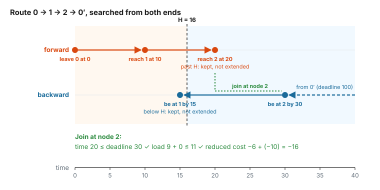

# 5. Searching from both ends

Every algorithm on page 4 grows its labels from the source. This page is about the other two ways `rcspp` can search:
**backward**, from the sink, and **bidirectionally**, from both ends at once. It covers:

- what a label means when it is built **backward**, for cost, load and time;
- how a forward half and a backward half are **joined** into one route;
- where the two searches stop: the **half-way point**;
- why the ng-path and elementary memories of page 3 need care at the join;
- the **model checks** the library runs before such a search;
- when a bidirectional search is worth it.

All numbers on this page come from running the library on the pricing graph of page 2 (time windows, capacity 11,
all duals $\pi_i = 20$), unless stated otherwise. As on page 4, $0'$ is the copy of the depot where routes end.

---

## 5.1 Why search from both ends

The number of labels grows quickly with the length of the paths. Each label can be extended along several arcs, and
dominance only removes part of the result, so every extra step multiplies the work. A route that visits 20 customers
needs labels for its prefixes of length 1, 2, …, 20, and at each length there are many competing prefixes.

A bidirectional search runs two shorter searches instead. One grows paths forward from the source, the other grows
them backward from the sink, and each stops around the middle. Two searches of half the length create far fewer
labels than one of full length. The price is a third step, the **join**, which combines a forward half and a
backward half into complete routes.

The rest of the page builds this up in three steps: what a backward label is (5.2), how two halves are joined (5.3),
and where the halves stop (5.4).

---

## 5.2 Backward labels

A forward label at node $v$ describes a partial path from the source to $v$, a **prefix**. A backward label at $v$
describes a partial path from $v$ to the sink, a **suffix**. It is built by starting at the sink and following arcs
in reverse.

A backward label must answer one question: *can a prefix that reaches $v$ be completed by this suffix, and at what
cost?* So each resource stores something slightly different going backward:

| resource | forward label at $v$ | backward label at $v$ | backward start at $0'$ | backward step along arc $i \to j$ |
|---|---|---|---|---|
| reduced cost | cost of the prefix | cost of the suffix | 0 | add the arc's reduced cost |
| load | load collected so far | load the suffix will still collect | 0 | add the arc's load (the demand of $j$) |
| time | arrival time at $v$ | **latest** time to be at $v$ and still finish: a **deadline** | the sink's latest time | $\min(l_i,\ d_j - t_{ij})$, impossible if below $e_i$ |

Here $[e_i, l_i]$ is node $i$'s time window, $t_{ij}$ the travel time and $d_j$ the deadline at $j$. A backward label
at $v$ does not count $v$'s own demand: the arc *into* $v$ belongs to the prefix, so the forward half counts it.

### Deadlines instead of arrival times

Follow the suffix $2 \to 0'$ backward:

- At $0'$ the deadline is the sink's latest time, 100.
- Step back along $2 \to 0'$ (10 time units). To reach $0'$ by 100, the vehicle must be at 2 by 90. But node 2 closes
  at 30, so the deadline at 2 is $\min(30, 90) = 30$.
- Step back along $1 \to 2$ (4 units): be at 1 by $\min(15, 30 - 4) = 15$.

Any arrival at 1 up to 15 works, because a vehicle that reaches 2 early simply waits for it to open. The forward
search handles waiting by raising the arrival time to the opening time. The backward search never needs to: a
deadline only says "no later than".

A deadline below the opening time is impossible. Stepping back from the suffix $3 \to 0'$ (deadline 18 at 3) along
$2 \to 3$ (6 units) asks for the vehicle to be at 2 by 12, but 2 only opens at 20. The forward search agrees: leaving
2 at 20 at the earliest reaches 3 at 26, after it closes at 18. So the backward label is discarded.

In the library's words, the cost and an additive load are **accumulations**: going backward they add up the suffix,
starting from zero. A time window is a **threshold**: going backward it carries a bound on the forward value (here,
on the arrival time). A capacity can also be written as a threshold, with `CapacityExtensionFunction`: its backward
label then holds the **capacity left** for the prefix, $Q$ minus the suffix's load.

### Dominance going backward

The rule of page 3 still applies: a label dominates another at the same node if it is at least as good on every
resource. What "good" means flips for the threshold:

- lower suffix cost is better;
- less suffix load is better;
- a **later** deadline is better, since it accepts more prefixes.

At node 1, the suffix $1 \to 2 \to 0'$ (cost −26, deadline 15, load 5) dominates $1 \to 3 \to 0'$ (cost −25,
deadline 13, load 6): it is cheaper, leaves more time and needs less capacity.

### A backward search on its own

`solve(direction="backward")` runs `simple` from the sink, with backward labels only. When a backward label reaches
the source, it is a complete route. On page 2's graph:

| direction | routes returned |
|---|---|
| forward | $0 \to 1 \to 2 \to 0'$ (−16), $0 \to 1 \to 3 \to 0'$ (−15) |
| backward | $0 \to 1 \to 2 \to 0'$ (−16), $0 \to 3 \to 2 \to 0'$ (−14) |

Both searches are exact, so both find the best route, −16. The other routes differ because dominance discards
different labels in each direction. Going forward, $0 \to 3 \to 2$ is dominated at node 2 (page 2's example), so
the −14 route is lost. Going backward, the suffix $1 \to 3 \to 0'$ is dominated at node 1 (above), so
$0 \to 1 \to 3 \to 0'$ is never built. The other −15 route, $0 \to 3 \to 1 \to 0'$, is dominated at the source by
$0 \to 1 \to 2 \to 0'$, which is cheaper, uses less capacity and can leave the depot later. In column generation,
both answers are valid: every route returned has a negative reduced cost, and both searches prove the same optimum.

---

## 5.3 Joining two halves

A forward label at $v$ and a backward label at $v$ together describe one route: the prefix up to $v$, then the
suffix from $v$. The **join** decides, resource by resource, whether that route is feasible:

| resource | join test | route value |
|---|---|---|
| reduced cost | none | prefix cost + suffix cost |
| load (additive) | prefix load + suffix load $\le Q$ | |
| load (as a threshold) | prefix load $\le$ capacity left | |
| time | arrival time $\le$ deadline | |

Take the forward label $0 \to 1 \to 2$ (cost −6, time 20, load 9) and the backward label $2 \to 0'$ (cost −10,
deadline 30, load 0) at node 2:

- time: $20 \le 30$ ✓
- load: $9 + 0 \le 11$ ✓
- cost: $-6 + (-10) = -16$

That is route $0 \to 1 \to 2 \to 0'$, with the reduced cost page 2 found. Now try the forward label $0 \to 1 \to 3$
(cost −5, time 15, load 10) with the backward label $3 \to 2 \to 0'$ (cost −24, deadline 18, load 5) at node 3. Time
is fine ($15 \le 18$), but the load is not: $10 + 5 = 15 > 11$. The join refuses this pair.

The join only compares values: it never extends a label. Each half was already checked for feasibility on its own
side, so the join only has to check what neither half could see alone, the totals.

---

## 5.4 Where the halves meet: the half-way point

If both searches ran to the end and every forward label were joined with every backward label at every node, the
search would do *more* work than a forward search, not less. Each route would also be found many times, once per
node it visits. Two things are needed: a place where each search stops, and a rule that finds each route once.

Both come from a **clock**: a resource that never decreases along an arc, such as time. Choose a **half-way point**
$H$ on it:

- a forward label whose time is **above** $H$ is kept, but not extended further;
- a backward label whose deadline is **below** $H$ is kept, but not extended further;
- the join pairs each forward label that crossed $H$ on its last arc (a **boundary label**) with the backward labels
  at the same node.

Since time never decreases along a route, each route crosses $H$ on exactly one arc. So the join can only build a
route at one node, the head of that arc, and never builds it twice.



### The toy graph with H = 16

The route $0 \to 1 \to 2 \to 0'$ is at time 10 at node 1 and 20 at node 2. With $H = 16$ it crosses $H$ on arc
$1 \to 2$. The forward search stops at node 2, and the backward search stops at node 1. The join at node 2 completes
the route (figure above).

On the whole graph, the forward search keeps these labels:

| node | prefix | cost | time | load | |
|---|---|---|---|---|---|
| 1 | $0 \to 1$ | 10 | 10 | 4 | extended |
| 1 | $0 \to 3 \to 1$ | −5 | 15 | 10 | extended |
| 3 | $0 \to 3$ | 10 | 10 | 6 | extended |
| 3 | $0 \to 1 \to 3$ | −5 | 15 | 10 | extended |
| 2 | $0 \to 2$ | 10 | 20 | 5 | above $H$: boundary label |
| 2 | $0 \to 1 \to 2$ | −6 | 20 | 9 | above $H$: boundary label |
| $0'$ | $0 \to 1 \to 0'$ | 0 | 20 | 4 | complete route |
| $0'$ | $0 \to 1 \to 3 \to 0'$ | −15 | 25 | 10 | complete route |

The labels not listed were dominated: $0 \to 3 \to 2$ by $0 \to 1 \to 2$ (page 2's example), $0 \to 3 \to 0'$ by
$0 \to 1 \to 0'$, and $0 \to 3 \to 1 \to 0'$ by $0 \to 1 \to 3 \to 0'$ (they tie).

And the backward search keeps these:

| node | suffix | cost | deadline | load | |
|---|---|---|---|---|---|
| $0'$ | (start) | 0 | 100 | 0 | extended |
| 2 | $2 \to 0'$ | −10 | 30 | 0 | extended |
| 3 | $3 \to 0'$ | −10 | 18 | 0 | extended |
| 3 | $3 \to 2 \to 0'$ | −24 | 18 | 5 | extended |
| 1 | $1 \to 0'$ | −10 | 15 | 0 | below $H$: stopped |
| 1 | $1 \to 2 \to 0'$ | −26 | 15 | 5 | below $H$: stopped |
| 1 | $1 \to 3 \to 2 \to 0'$ | −39 | 13 | 11 | below $H$: stopped |
| 0 | $0 \to 2 \to 0'$ | 0 | 20 | 5 | complete route |
| 0 | $0 \to 3 \to 2 \to 0'$ | −14 | 8 | 11 | complete route |

Here $1 \to 3 \to 0'$ was dominated at node 1 (section 5.2), and $0 \to 3 \to 0'$ at the source by
$0 \to 2 \to 0'$ (later deadline, less load, same cost).

### Three ways to find a route

Complete routes come from three places:

1. **Forward labels that reach the sink.** $0 \to 1 \to 3 \to 0'$ is at time 15 at node 3, still below $H$, so the
   forward search extends it to the sink itself. Its crossing arc is the last one.
2. **Backward labels that reach the source.** The deadline of $3 \to 2 \to 0'$ at node 3 is 18, still above $H$, so the
   backward search extends it to the source: $0 \to 3 \to 2 \to 0'$.
3. **The join.** The boundary labels at node 2 meet the backward label $2 \to 0'$ there, which gives
   $0 \to 2 \to 0'$ (cost 0) and $0 \to 1 \to 2 \to 0'$ (−16).

A route found twice, like $0 \to 2 \to 0'$ here, is kept once. With the pricing bound `upper_bound=-1e-9`, the solve
returns:

| route | reduced cost | found by |
|---|---|---|
| $0 \to 1 \to 2 \to 0'$ | −16 | the join |
| $0 \to 1 \to 3 \to 0'$ | −15 | the forward search |
| $0 \to 3 \to 2 \to 0'$ | −14 | the backward search |

The best route is the same as forward, −16. The bidirectional search also returns the −14 route, which the forward
search had discarded at node 2. Its set of routes is usually **larger** than a forward search's: two halves that
are each undominated where they meet are joined even if the whole route would have been dominated at the sink. Every
route it returns is feasible, at its stated cost.

### Choosing H

The library takes the clock's range to be $[0, 2H]$, so $H$ should be about half the range that routes actually use.
On this graph, routes end between times 20 and 30.

| $H$ | what happens | routes returned |
|---|---|---|
| 16 | both halves do part of the work; one route comes from the join | −16, −15, −14 |
| 100 | nothing crosses $H$: the forward search does all the work, and the backward search stops after one step | −16, −15 |
| 0 (the default) | **no split**: both searches run to the end, and the join pairs every forward label with every backward label | −16, −15, −15, −14 |

All three are exact. Without a split (the default, $H = 0$) the search is a full forward search plus a full backward
search plus a join, which is *slower* than a forward search alone. The library logs a warning when this happens.

### What makes a valid clock

The clock is a resource of the model, chosen with `critical_resource_index`. It must:

- **never decrease along an arc**, so that each route crosses $H$ exactly once;
- be a **threshold** going backward (a time window, or a capacity written with `CapacityExtensionFunction`), so that
  forward and backward values are on the same scale and "below $H$" means the same thing for both;
- be **part of dominance, lower is better** (`ValueDominanceFunction`). Otherwise a label above $H$ could dominate,
  and remove, a label below $H$ that the join needed.

The **cost is never a valid clock**: reduced costs are negative on some arcs, so the cost can decrease along a
route. If the chosen resource breaks a rule, the library switches the split off and says why. The solve stays
exact, only slower: `result.bidirectional.bounded_by_half_way` is then `False`, and
`result.bidirectional.half_way_off_reason` gives the reason.

:::{note}
The split is exact only when the clock's arithmetic is. The backward search subtracts travel times from deadlines,
and in floating point $(a + b) - b$ is not always $a$. A route that reaches a deadline *exactly* can then be lost.
With times that are integers, or that sum without rounding, the bidirectional and forward searches agree exactly.
:::

---

## 5.5 Memories at the join

The join must also respect the ng-path and elementary memories of page 3. A forward label at $v$ remembers some
customers visited **before** $v$, and a backward label at $v$ remembers some customers visited **after** $v$. The
joined route revisits a remembered customer exactly when some customer is in **both** memories. So the join test for
a memory is: the two sets share no customer that is forbidden at itself.

### An example

Take page 3's variant without time windows, with capacity 13, where the cycle $0 \to 1 \to 2 \to 1 \to 0'$ is feasible
(page 3, section 3.4). Use page 3's neighbourhoods, $N(1) = N(2) = \{1, 2\}$, and meet at node 2:

- the forward half $0 \to 1 \to 2$ stores $\{1\}$ at node 2: customer 1 was visited before 2;
- the backward half $2 \to 1 \to 0'$ also stores $\{1\}$ at node 2: customer 1 comes after 2.

Customer 1 is in both, so the join refuses the pair, and the cycle is never built. This graph has no time, so the
clock is the load, written as a capacity, with $H = 6.5$. Without a memory, the bidirectional search on it returns the
cycle, with reduced cost −32. With the ng memory, its best routes are $0 \to 1 \to 2 \to 0'$ and its reverse, both
−16, as page 3 found.

### Why the memory must come from the arc's endpoints

Page 3's note showed that `NgPathExtensionFunction` reads the node it adds from the arc's **endpoints**, not from a
value stored on the arc. Going forward, a step along $i \to j$ adds $i$, the node being left. Going backward, the
same step leaves $j$, so it adds $j$. In both directions, the memory at a node never contains that node itself,
and the test "is $v$ in my memory at $v$" means the same thing.

A visited set built with `UnionExtensionFunction` and the value $\{i\}$ on each arc $i \to j$ (page 3, section 3.5)
does not have this property. The value is the same in both directions, so going backward the step along $i \to j$
adds $i$, the node it *arrives* at. Every backward label then contains its own node and is refused immediately. That
is why the presets build elementary paths as ng-paths with every node in every neighbourhood.

---

## 5.6 What the model must declare

A forward search only uses the forward functions of each resource. A backward search also needs every resource to
say how it behaves backward: where a backward label starts, how it is extended, and what a backward value means. A
bidirectional search also needs to know how to join two halves. If any of this is missing or inconsistent, the search
would return infeasible routes, or miss feasible ones, while reporting `complete`.

So before every backward or bidirectional solve, the library runs **model checks** on the whole model. A model that
fails them is refused before any label exists (`RuntimeError` in Python), with one line per problem. Some examples
of what is refused, and why:

| model | why it is refused |
|---|---|
| a visited set built with `UnionExtensionFunction` (section 5.5) | going backward, every label contains its own node and is rejected |
| a load with a **minimum** at some node, under a threshold extension | a backward label only carries a ceiling, so nothing can check that the prefix reached the minimum |
| an arc with a **negative** load | a backward label cannot see the load dip below 0 inside the suffix |
| a cost that reads a time window's value | the join adds the costs of the two halves, but a backward time value is a deadline, not a cost |

On the visited set of section 5.5, the check reads (shortened):

```text
component 2: its feasibility function forbids each node at itself, which only reads correctly backwards when the
memory at a node excludes that node; its extension function does not declare BackwardKind::ArcEndpoints, ...
```

`check_model` runs the checks without solving and returns the list of problems, empty when the model is ready.
Forward solves run no check. The library's own functions and the presets declare everything the checks need;
[Model checks](../advanced/algorithms.md#model-checks) lists every complaint and its fix.

---

## 5.7 When it pays off

A bidirectional search does two searches and a join, so on small or easy instances it does more work than a forward
search. It pays off when dominance has **many labels to compare at each node**. Dominance compares a new label with
every label at its node, so halving the number of labels per node saves more than half the work.

The library measured this on Solomon instances (see
[When it pays, and when it does not](../advanced/algorithms.md#when-it-pays-and-when-it-does-not)), and the
deciding factor was how many labels the forward search extends:

| labels extended by a forward search | bidirectional speed-up |
|---|---|
| under about 13 000 | 0.8×: slightly slower |
| about 13 000 to 100 000 | 1.0× to 4.2× |
| about 100 000 to 1 million | 1.3× to 6.2× |
| over 3 million | 35× to 41× |

So it is not the default. It helps most on instances with long routes and many surviving labels, and it needs a good
clock: time windows that make routes long in time, or a binding capacity.

---

## 5.8 In code

### Python

On page 2's graph:

```python
from rcspp.graph import AlgorithmParams

print(rg.check_model("bidirectional"))             # [] : the model is ready

p = AlgorithmParams()
p.critical_resource_index = 1                      # the clock: resource 1, time
p.half_way_point = 16.0                            # H
result = rg.solve(algorithm="bidirectional", upper_bound=-1e-9, params=p)
for sol in result.solutions:
    print(sol.cost, sol.path_node_ids)
# -16.0 [0, 1, 2, 4]
# -15.0 [0, 1, 3, 4]
# -14.0 [0, 3, 2, 4]

stats = result.bidirectional                       # None for the other algorithms
print(stats.bounded_by_half_way, stats.number_of_joined_paths)   # True 1

result = rg.solve(direction="backward", upper_bound=-1e-9)       # backward only
```

`critical_resource_index` counts within the cost's resource type: here the three resources are all real, and the
clock is the second one. `algorithm="bidirectional"` is the same as `algorithm="simple"` with
`direction="bidirectional"`.

The presets build resources whose backward functions match, so they are the simplest way to write a model meant for
these searches. Page 2's model, with the presets:

```python
from rcspp import presets

presets.add_cost_resource(rg)                              # resource 0: reduced cost
presets.add_window_resource(rg, "real", time_windows)      # resource 1: time
presets.add_capacity_resource(rg, "real", 11.0)            # resource 2: load, a threshold
# for ng-paths or elementary paths: presets.add_ng_path_resource / add_elementary_resource (page 3)
```

It returns the same three routes with $H = 16$.

### C++

```cpp
rcspp::AlgorithmBaseParams params;
params.direction = rcspp::SearchDirection::Bidirectional;
params.critical_resource_index = 1;                // the clock, within the cost's resource type
params.half_way_point = 16.0;
auto result = graph.solve<rcspp::SimpleDominanceAlgorithm>(params, -1e-9);

const auto report = graph.check_model(rcspp::SearchDirection::Bidirectional);   // report.problems
```

`SearchDirection::Backward` searches backward only. A clock of another type than the cost, for example an integer
time with a real cost, is given as the last template parameter of `solve`; see
[`Bidirectional`](../advanced/algorithms.md#bidirectional).

---

## Check yourself

1. A backward label at node 3 has deadline 18. It is extended backward along arc $1 \to 3$, which takes 5 time units,
   and node 1's window is $[0, 15]$. What is the new deadline? And along $2 \to 3$ (6 units), with node 2's window
   $[20, 30]$?
2. Why does a backward label at $v$ not count $v$'s own demand?
3. With $H = 16$, why is $0 \to 1 \to 3 \to 0'$ found by the forward search and not by the join?
4. Why can't the reduced cost be used as the clock?
5. A bidirectional solve returns −16, −15, −14, and a forward solve returns −16, −15. Is one of them wrong?
6. Why would a visited set built from arc values $\{i\}$ reject every backward label?

### Answers

1. Along $1 \to 3$: $\min(15, 18 - 5) = 13$. Along $2 \to 3$: $18 - 6 = 12$, below node 2's opening time 20, so the
   label is impossible and discarded.
2. The arc into $v$ belongs to the forward half, and it is that arc that carries $v$'s demand. Counting it in both
   halves would count it twice at the join.
3. Its time at node 3 is 15, below $H$, so the forward search extends it. It only crosses $H$ on its last arc, which
   ends at the sink, so the forward search completes the route itself. (A route found more than once is kept once.)
4. The clock must never decrease along an arc, so that each route crosses $H$ exactly once. Reduced costs are
   negative on many arcs.
5. No. Both are exact and find the same best route. The other routes differ because dominance removes different
   labels; every route returned is feasible and has a negative reduced cost.
6. Going backward, the step along $i \to j$ adds the arc's value $\{i\}$ to a label that arrives at $i$. The label
   then contains its own node, and "is $i$ in my memory at $i$" is always true.
